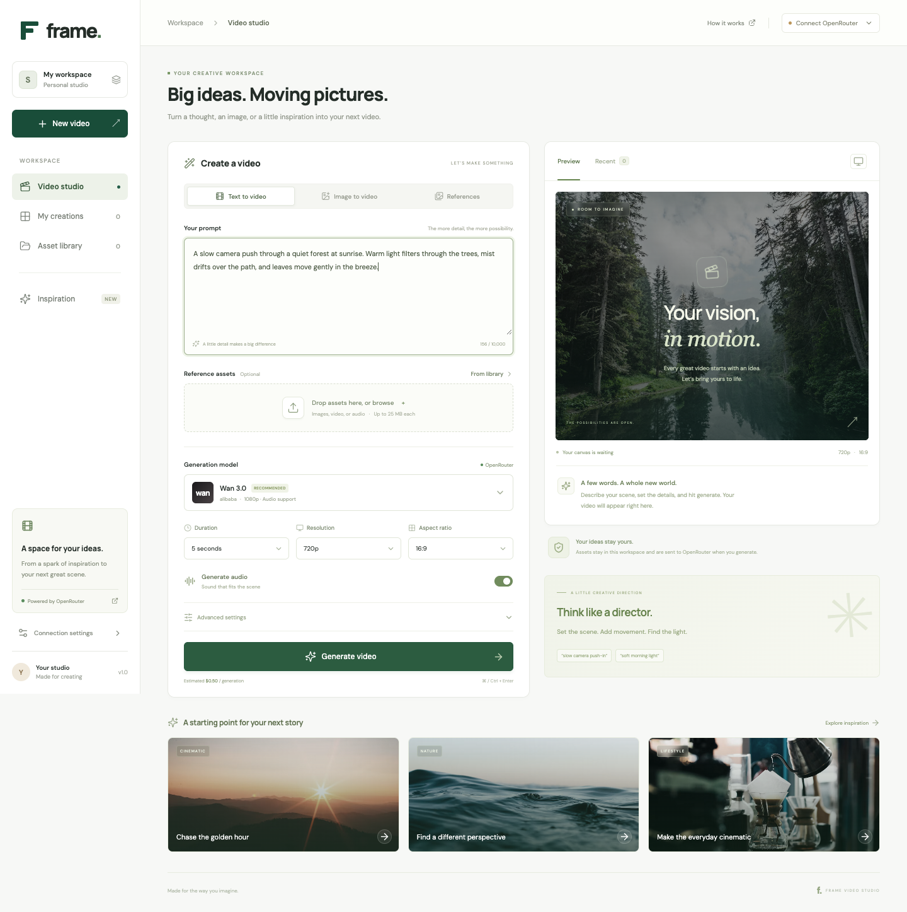
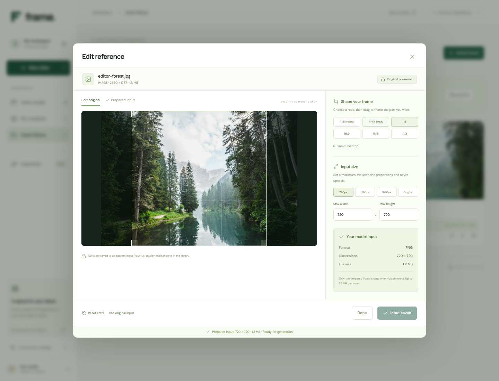
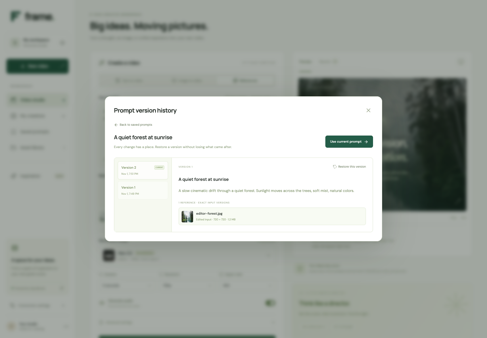
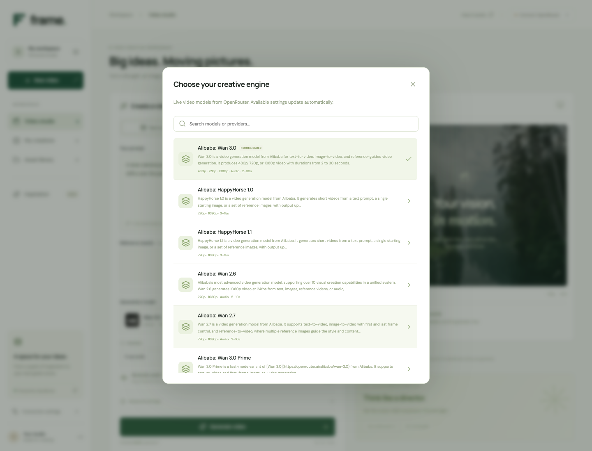
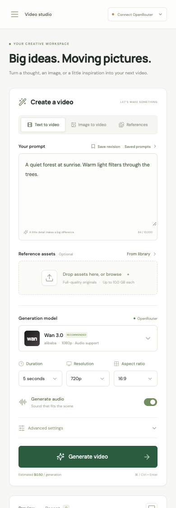

<div align="center">


# Frame

### Big ideas. Moving pictures.

A calm, creative workspace for turning your words, images, and references into AI videos.

[](https://nodejs.org/)
[](https://www.typescriptlang.org/)
[](https://openrouter.ai/)
[](LICENSE)

[Get started](#get-started) · [Take a look](#take-a-look) · [Common questions](#common-questions)

</div>



## A little imagination goes a long way

Describe a scene, choose how it should look, and let your selected video model bring it to life. Frame starts with **Wan 3.0** and discovers other available video models directly from OpenRouter, so you can explore different creative engines in one place.

- **Start with words.** Write a prompt or borrow a starting point from the inspiration gallery.
- **Keep your best prompts.** Name and save a prompt, refine it over time, and restore any earlier version from its history.
- **Bring your own ingredients.** Drop in photos, video clips, or audio, and reuse them from your asset library.
- **Keep the original. Edit the input.** Crop images or videos, choose maximum dimensions, and trim footage or sound. Your full-quality originals stay untouched.
- **Frame the scene.** Use an image to guide the first or last frame on models that support it.
- **Make it your own.** Choose duration, resolution, aspect ratio, and audio, with more controls when a model offers them.
- **Keep your creative flow.** Follow generation progress while working on your next idea. Run up to three generations at once.
- **Watch, download, revisit.** Preview finished clips, download your favorites, and find past generations in My creations.

No graphics card or local AI installation needed. OpenRouter handles the generation.

## Get started

You’ll need:

1. **[Node.js](https://nodejs.org/)** — version 22.12 or newer. The current LTS version is a good choice.
2. **An [OpenRouter API key](https://openrouter.ai/settings/keys)** and credits for generating videos. Think of the key as the connection between your studio and the video models.
3. **[FFmpeg](https://ffmpeg.org/download.html)** for editing video and audio. On a Mac with Homebrew, run `brew install ffmpeg`. On Windows or Linux, use the download page and make sure both `ffmpeg` and `ffprobe` are available in your terminal. Image editing works without it.

### 1. Open the project

Clone this repository, or choose **Code → Download ZIP** on GitHub and unzip it. Open a terminal in the `Frame` folder.

### 2. Start your studio

Run these commands, one at a time:

```bash
npm install
npm run dev
```

Open **[http://127.0.0.1:3000](http://127.0.0.1:3000)** in your browser. Leave the terminal running while you use Frame.

### 3. Connect and create

Click **Connect OpenRouter** in the top-right corner, paste your API key, and connect. Then:

1. Describe the video you have in mind.
2. Add reference assets if you like.
3. Pick a model and adjust the video settings.
4. Click **Generate video**. Your progress and finished video appear in Preview.

When it’s ready, click **Download** to keep a copy.

> **Your first prompt:** “A slow camera push through a quiet forest at sunrise. Warm light filters through the trees, mist drifts over the path, and leaves move gently in the breeze.”

To open the studio another day, run `npm run dev` again. To stop it, press **Ctrl + C** in the terminal.

## Take a look

### Big originals. Just the right input.

Have a long 4K recording, but only need five seconds? Upload the original to **Asset library**, then click its **pencil icon**. Scrub to the moment you want and choose **Use 5s here**, or enter exact start and end times. Frame the shot, set a maximum size, and click **Save input**.



Switch to **Prepared input** to see exactly what will be sent to the model. You can close the editor while preparation runs, reopen it to adjust your edits, or choose **Use original input** to undo them. Edit icons are also available on attached references and frame images in the studio.

Your original stays in the library byte for byte. Photos are prepared as PNG, video as MP4, and audio as WAV. Prepared inputs keep their proportions, never upscale the source, and must fit within 25 MB each.

### Save an idea. Keep every version.

Click **Save prompt** above the prompt field and give your idea a name. Find it later in **Saved prompts**, then choose **Use prompt** to load it into the studio. After making changes, choose **Save revision**.

Attached references are saved too, including the exact crop, resize, video trim, or audio trim you chose. Loading a prompt brings those inputs back, even if you have since edited the library asset again. You can review or remove the included references before saving.

Open a saved prompt’s **History** to compare earlier versions. **Restore this version** makes that version current by adding a new revision; the versions that followed it stay available. **Save as new prompt** lets you branch an idea into a separate saved prompt.

Each revision keeps its own reference selections and edits. To keep that history usable, an asset used by any saved revision stays in your library until the saved prompt is deleted.



### Choose the right model for your idea

Search available models and compare their supported settings. The studio updates its controls when you choose a model.



<details>
<summary><strong>See the mobile layout</strong></summary>
<br />
<p>The studio adapts to smaller screens, with a collapsible menu and controls that stack naturally.</p>

</details>

<sub>Screenshots show the real interface. The forest photograph in the empty preview is inspiration imagery; your generated video appears there when it’s ready.</sub>

## A few small tips

| If you want… | Try… |
| --- | --- |
| A cinematic feel | Mention the camera movement, lighting, and mood. |
| A familiar starting image | Choose **Image to video** and add a first frame. |
| Guidance from several assets | Choose **References** and add your ingredients. |
| A vertical video | Pick **9:16** under Aspect ratio, when available. |
| A quick experiment | Start with a shorter clip and a lower resolution. |
| To try a variation | Find the generation in **My creations** and choose **Reuse prompt**. |
| Five seconds from a long recording | Open the asset editor, scrub to the moment, and click **Use 5s here**. |
| A smaller reference without losing the original | Set **Max width** and **Max height** in the editor, then **Save input**. |

**Mac:** ⌘ + Enter · **Windows / Linux:** Ctrl + Enter — generate from the prompt field.

## Common questions

<details>
<summary><strong>Is Frame free?</strong></summary>

Frame is free, open-source software. Video generation uses your OpenRouter account and may cost money. The studio shows an estimate when the model’s pricing makes that possible, and the actual charge when OpenRouter reports it. Provider rates and reference inputs can affect the final price.

</details>

<details>
<summary><strong>Which files can I upload?</strong></summary>

Common image, video, and audio formats are supported, including JPG, PNG, WebP, GIF, AVIF, MP4, MOV, WebM, MP3, WAV, OGG, FLAC, M4A, and AAC. You can upload up to 12 originals at once, with a default limit of 10 GB each. Uploads stream directly to local storage, so long sources stay at their original quality. The limit can be changed in the settings file described in the development guide.

AI inputs have a separate limit: 25 MB per asset and 50 MB per generation in total. Use the editor to trim or resize large originals before generating. Animated image originals are preserved; a prepared image uses their first frame.

Images can be used as references or, when supported, first and last frames. Video and audio guidance requires a compatible provider, such as BytePlus with Seedance 2 or newer. Other providers may ignore those references. Frame images and reference assets are separate generation modes, so use one mode at a time.

</details>

<details>
<summary><strong>Why do the options change between models?</strong></summary>

Each model has its own capabilities. Frame reads those from OpenRouter and shows the available choices. A disabled setting means that model does not expose that control. Providers can also have additional restrictions, which appear as an error if a request cannot be served.

</details>

<details>
<summary><strong>Where do my key and files go?</strong></summary>

A key entered in the app stays in the server’s memory and expires after 24 hours of inactivity. Restarting the server clears it. Frame never saves that key in browser storage or on disk.

Uploads and generation history live in the local `data` folder. Your browser session identifies your workspace, so reopen Frame in the same browser to see it again. Your prompt draft is saved in that browser. References are sent to OpenRouter and the selected provider when you generate; their data policies apply.

Asset edits create a separate prepared file. The original is never overwritten, and only your prepared input is sent when one is saved. Unedited assets use the original if it fits within the input limits.

Video and audio references need an HTTPS link that OpenRouter can fetch. On a local install, Frame starts a separate, file-only Cloudflare Quick Tunnel when needed. It shares only temporary copies of the selected model inputs through unguessable links, and revokes those links when the generation reaches a final status. Links expire after two hours unless an active job renews them. Your studio, API key, and other library files are not served through that tunnel. Cloudflare carries the reference transfer; OpenRouter and the provider receive the selected input.

The first video/audio reference may take a little longer while HTTPS sharing starts. Frame checks multiple DNS services and verifies that its reference server can be reached over HTTPS before submitting a generation. DNS checks can take up to two minutes; if they time out, retrying reuses the same address while it warms up. The helper stays available for ten minutes after its last reference is released. The `cloudflared` helper is installed automatically by the dependency or on first use. Hosted installations can configure their own stable HTTPS origin instead.

Saved prompts and their version histories are stored locally with your workspace. They survive server restarts; reopen the studio in the same browser to find them.

Generated videos are fetched from OpenRouter. Download the clips you want to keep, since availability depends on the service’s retention period.

</details>

<details>
<summary><strong>Can I close the browser while a video is generating?</strong></summary>

Yes, as long as the Node.js server stays running. It keeps checking active jobs in the background. If you restart the server, reconnect your key and open the studio to resume status checks. Closing the browser does not cancel a submitted generation.

For video/audio references, keep Frame running until the job finishes: the provider may still need to fetch the temporary input link. Restarting Frame ends local tunnel links.

</details>

<details>
<summary><strong>Something isn’t working. What should I try?</strong></summary>

- **The page won’t open:** make sure `npm run dev` is still running and use the local address printed in the terminal.
- **Your key won’t connect:** check that it’s an OpenRouter key, that it’s active, and that you copied the whole value.
- **A generation fails:** read the error in the preview. Check your credits, try a different setting or model, or adjust the prompt.
- **A video won’t play:** reconnect your key, then try downloading the video. Older outputs may no longer be available from OpenRouter.
- **The model list won’t load:** check your internet connection and use **Retry model discovery**.

</details>

## Want to go a little further?

For environment settings, production builds, tests, and how the project is organized, see the **[development guide](docs/DEVELOPMENT.md)**. The default setup is a personal studio running on your computer; hosting a shared service needs additional sign-in and deployment setup.

Found a bug or have an idea? Open an issue. Contributions are welcome.

## License & credits

Released under the **[MIT license](LICENSE)**. You can use, modify, and share Frame, including for commercial projects, under that license. Model access, generated content, and third-party assets remain subject to their respective terms.

Built with React, TypeScript, Node.js, and Express. Video generation by [OpenRouter](https://openrouter.ai/), icons by [Lucide](https://lucide.dev/), and inspiration photography from [Unsplash](https://unsplash.com/).

<div align="center">
<sub>Made for the way you imagine.</sub>
</div>
